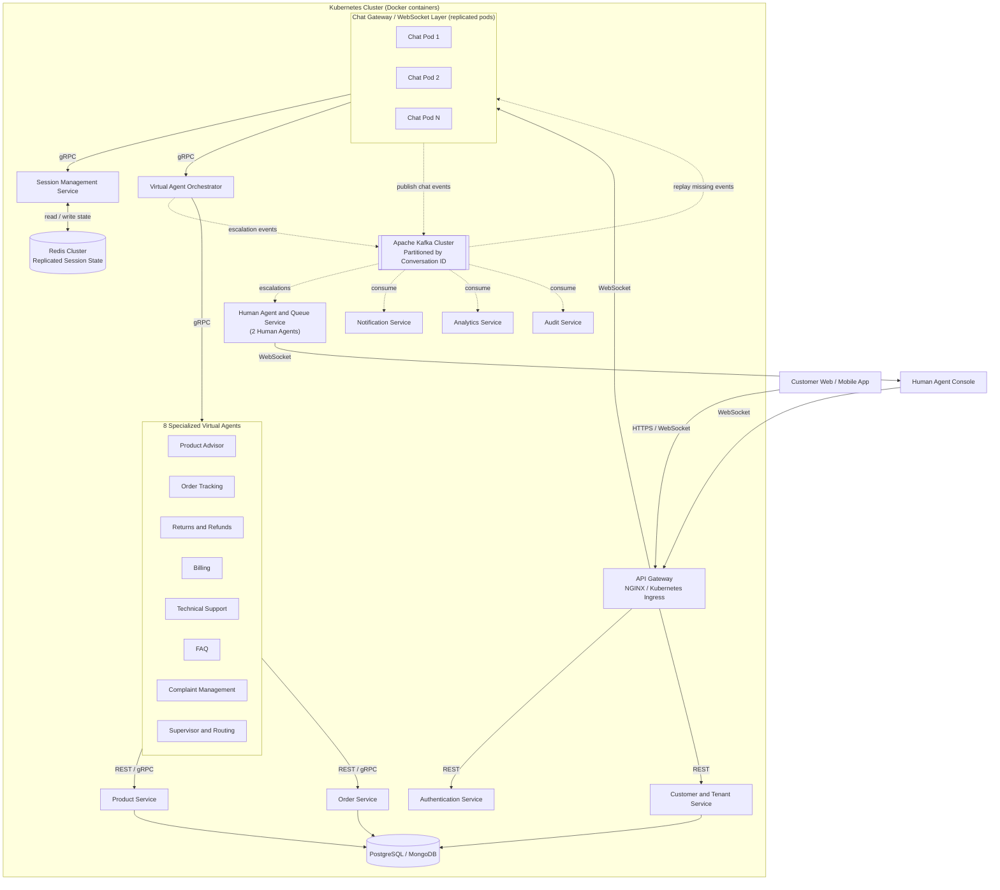

# EngageHub: A Fault-Tolerant Hybrid AI–Human Customer Engagement Platform with Reliable Live-Chat Migration

## Abstract

Enterprise customer-support platforms keep thousands of live conversations open at the same time. In most systems, a single server crash, network partition, or rolling deployment can disconnect customers, lose messages, and force them to repeat their problem. **EngageHub** is a proposed distributed, enterprise-grade customer-engagement platform, inspired by products such as TouchCommerce. It combines a hybrid workforce of **eight specialized virtual AI agents and two human support agents** to provide real-time chat, product assistance, order tracking, recommendations, notifications, and intelligent escalation. EngageHub will be built as a set of independently deployable microservices. **Apache Kafka** will carry asynchronous, event-driven communication between them, and they will run in **Docker** containers orchestrated by **Kubernetes**. The project's core challenge is **Global Session State Reconciliation and Reliable Live-Chat Migration During Failures**. Active session state will be replicated in a **Redis Cluster**. Every chat message will be stored as an ordered, durable Kafka event, partitioned by conversation ID. When a Chat Service pod fails, the customer's WebSocket connection will move to a healthy pod. That pod will restore the session from Redis and replay missing events from Kafka, and it will use sequence numbers and idempotency keys to guarantee that **no acknowledged message is lost and no duplicate message is shown to the user**.

## Business Value

- **Better customer support:** Customers will get instant help 24/7 from specialized virtual agents for products, orders, returns, billing, technical issues, FAQs, and complaints. Human agents will be reserved for complex, sensitive, VIP, or frustrated customers.
- **Lower response time:** The Supervisor and Routing Agent will send each question directly to the right specialized agent. This avoids generic bot responses and long human queues.
- **Scalable support operations:** Kubernetes horizontal scaling will let the platform absorb traffic spikes, such as holiday sales or product launches, without hiring more staff or overloading servers.
- **No lost conversations during failures:** Customers will not see a dropped chat when a server crashes or a new version is deployed. Their conversation, context, and agent assignment will continue on another pod with no lost or repeated messages.
- **Smart AI-to-human handoff:** Sentiment and frustration detection, together with AI-generated conversation summaries, will help human agents understand a case immediately, without asking the customer to repeat it.
- **Higher customer satisfaction and retention:** A reliable, fast, and context-aware support experience builds trust and reduces abandoned carts and churn.
- **Multi-tenant SaaS potential:** One platform deployment can serve multiple businesses, which makes EngageHub a realistic, startup-worthy product.

**Why reliable session recovery matters:** For an enterprise, every dropped conversation can mean a lost sale, an unresolved complaint, or a compliance risk. Most chat platforms treat WebSocket connections as disposable, so any pod failure or deployment interrupts customers. EngageHub treats each live conversation as **durable, recoverable state**. This allows zero-downtime deployments and fault-tolerant operation, which is a key differentiator for large-scale customer-engagement businesses.

## Proposed Architecture Diagram

**Legend:** Solid arrows show **synchronous** communication (REST, gRPC, WebSocket). Dotted arrows show **asynchronous** event communication through **Apache Kafka**.

**How the architecture works:**

1. Customers connect through the **API Gateway**, which authenticates requests and routes WebSocket connections to one of several replicated **Chat Pods**.
2. Each chat message will receive a unique message ID, conversation ID, sequence number, timestamp, tenant ID, and correlation ID. It will be published to **Kafka** using the conversation ID as the partition key, which preserves per-conversation ordering.
3. The **Session Management Service** will store live session state in a **Redis Cluster**: assigned agent, workflow state, last acknowledged message ID, unacknowledged messages, and typing status.
4. The **Virtual Agent Orchestrator** will route requests to the right specialized agent, coordinate multi-agent collaboration, and publish escalation events when a human agent is needed.
5. **Failure recovery:** If a Chat Pod fails, Kubernetes will restart it and the gateway will reconnect the client to a healthy pod. The new pod will restore the session from Redis, read the last acknowledged message ID, and replay only the missing events from Kafka. Duplicates will be removed using message IDs and idempotency keys.
6. **Notification, Analytics, and Audit** services will consume Kafka events independently through separate consumer groups, so a slow or failed consumer will never block live chat.

## Proposed Technology Used

| Technology | Purpose |
|---|---|
| **React** | Frontend for the customer chat application, the human agent console, and the analytics dashboard |
| **FastAPI / Spring Boot** | Backend frameworks for building independent microservices |
| **REST and gRPC** | REST for external client APIs; gRPC for fast, typed, synchronous service-to-service calls |
| **WebSockets** | Real-time, bidirectional chat between customers, virtual agents, and human agents |
| **Apache Kafka** | Durable, ordered event streaming for chat messages, escalations, notifications, analytics, and audit logs. The conversation ID is the partition key for ordering, consumer groups provide parallel processing, and event retention enables message replay after failures |
| **Redis Cluster** | Replicated, low-latency storage for active session state, agent availability, and idempotency keys, which enables chat migration between pods |
| **PostgreSQL / MongoDB** | Persistent storage for customers, tenants, products, orders, conversation history, and audit records |
| **Docker** | Packages each microservice with its dependencies into a portable, consistent container image |
| **Kubernetes** | Orchestrates containers with Deployments, Services, rolling updates, liveness/readiness probes, self-healing pod restarts, and Horizontal Pod Autoscaling |
| **NGINX / Kubernetes Ingress** | API gateway for routing, load balancing, TLS termination, and WebSocket connection handling |
| **Prometheus** | Collects metrics such as message latency, active sessions, Kafka consumer lag, and pod health |
| **Grafana** | Dashboards for visualizing system health, agent workload, and failure-recovery behavior |
| **OpenTelemetry** | Instruments services to generate traces, using correlation IDs across synchronous and asynchronous calls |
| **Jaeger** | Visualizes distributed traces to debug latency and failures across microservices |
| **GitHub Actions** | Continuous integration: automated builds, tests, and Docker image creation |

### Distributed-Systems Patterns Used

- **Event-driven architecture:** Services communicate through Kafka events for loose coupling.
- **Microservices:** Independently deployable and scalable services.
- **Kafka partitions and consumer groups:** Per-conversation ordering and parallel event processing.
- **Replicated session state:** Redis Cluster keeps live chat state available across pod failures.
- **Message replay:** Missing events are replayed from Kafka after reconnection.
- **Idempotent processing:** Message IDs and idempotency keys prevent duplicate processing and duplicate user-visible messages.
- **Retry with exponential backoff:** Transient failures are handled gracefully.
- **Dead-letter queues:** Events that keep failing are isolated for later inspection.
- **Circuit breakers:** Failing services are isolated to prevent cascading failures.
- **Timeouts:** Slow dependencies cannot block live conversations.
- **Kubernetes self-healing:** Failed pods are detected and restarted automatically.
- **Horizontal scaling:** Chat and agent services scale with traffic.
- **Distributed tracing:** Requests are tracked end to end across services and Kafka.
- **Fault-injection testing:** Pods are deliberately killed and networks disrupted to validate reliable live-chat migration.
