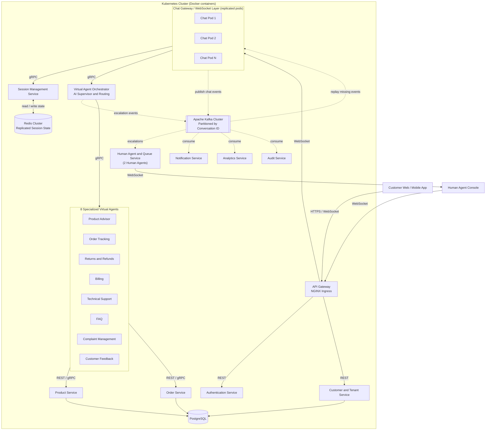

# EngageHub: A Fault-Tolerant Hybrid AI–Human Customer Engagement Platform with Reliable Live-Chat Migration

## Abstract

Enterprise customer support platforms need to manage a lot of concurrent conversations at the same time. Customers may however lose their chat connection, messages or conversation history in the case of a server crash, network problem or system update. Our proposed project Engagehub is a fault tolerant, multi tenant customer support platform which combines eight virtual AI agents and two human support agents. It helps customers search for products, receive recommendations, track orders, communicate through real-time chat, and also receive human assistance when needed.

EngageHub is expected to be developed as a group of independent microservices. These services will use Docker containers and be managed by Kubernetes. Apache Kafka will help the services to exchange events such as chat messages, agent assignments, escalations, notifications and analytics data. Redis Cluster will store active chat sessions, agent assignments, message status and other information needed to recover a conversation.

The main goal of the project is to support reliable live-chat migration when a Chat Service pod fails. Each message will have an unique ID and sequence number which will help the system preserve message order and prevent duplicate messages. If a Chat Service pod stops working, another healthy pod will restore the session from Redis and replay missing messages from Kafka. Kubernetes will restart failed pods and support service scaling. Prometheus, Grafana, OpenTelemetry and Jaeger will be used to monitor the system and trace requests across the services. The project will be evaluated using concurrent users, service failures, message recovery, agent escalation, response latency and recovery time.

## Business Value

- **24/7 customer support:** Specialized AI agents can handle product questions, order tracking, returns, billing, technical support, FAQs, complaints, and customer feedback at any time.
- **Faster issue resolution:** Intelligent routing directs each customer request to the appropriate AI agent or human support agent, reducing response time and unnecessary transfers.
- **Reduced operational cost:** AI agents handle routine questions, allowing human agents to focus on complex, sensitive, or escalated cases.
- **Scalable customer service:** Kubernetes can automatically scale chat and support services during traffic increases such as product launches or holiday sales.
- **Reliable customer conversations:** Replicated session state, Kafka event storage, and message replay allow conversations to recover when a service or pod fails.
- **Better AI-to-human handoff:** Sentiment detection and conversation summaries give human agents the necessary context without requiring customers to repeat their issue.
- **Improved customer satisfaction:** Faster responses, reliable conversations, and better routing can reduce abandoned chats and improve customer retention.
- **Multi-tenant business potential:** The platform can support multiple businesses using shared infrastructure while keeping their customer and conversation data logically separated.

The main business value of EngageHub is reliable, scalable customer engagement. Even when a service fails, the platform is designed to preserve conversation context and continue supporting the customer.

**Why reliable session recovery matters:** For an enterprise, every dropped conversation can mean a lost sale or an unresolved complaint. Most chat platforms treat WebSocket connections as disposable, so any pod failure or deployment interrupts customers. EngageHub treats each live conversation as **durable, recoverable state**. This supports fault-tolerant operation and reduces the impact of service failures during deployments or unexpected crashes.

## Proposed Architecture Diagram

**Legend:** Solid arrows show **synchronous** communication (REST, gRPC, WebSocket). Dotted arrows show **asynchronous** event communication through **Apache Kafka**.

**How the architecture works:**

1. Customers connect through the **API Gateway**, which authenticates requests and routes WebSocket connections to one of several replicated **Chat Pods**.
2. Each chat message will receive a unique message ID, conversation ID, sequence number, timestamp, tenant ID, and correlation ID. It will be published to **Kafka** using the conversation ID as the partition key, which preserves per-conversation ordering.
3. The **Session Management Service** will store live session state in a **Redis Cluster**: assigned agent, workflow state, last acknowledged message ID, unacknowledged messages, and typing status.
4. The **Virtual Agent Orchestrator**, acting as the AI supervisor and routing service, will route requests to the right specialized agent, coordinate multi-agent collaboration, and publish escalation events when a human agent is needed.
5. **Failure recovery:** If a Chat Pod fails, Kubernetes will restart it and the gateway will reconnect the client to a healthy pod. The new pod will restore the session from Redis, read the last acknowledged message ID, and replay only the missing events from Kafka. Duplicates will be removed using message IDs and idempotency keys.
6. **Notification, Analytics, and Audit** services will consume Kafka events independently through separate consumer groups, so a slow or failed consumer will never block live chat.

## Proposed Technology Used

| Technology | Purpose |
|---|---|
| **React** | Frontend for the customer chat application, human agent console, and analytics dashboard |
| **FastAPI** | Backend framework for implementing the microservices |
| **REST and gRPC** | REST for client-facing APIs and gRPC for typed service-to-service communication |
| **WebSockets** | Real-time, bidirectional communication for live customer support chats |
| **Apache Kafka** | Durable event streaming for chat messages, escalations, notifications, analytics, and audit events. The conversation ID is used as the partition key to preserve message order, and retained events enable message replay after failures |
| **Redis Cluster** | Fast, replicated storage for active session state, agent assignment, and idempotency keys |
| **PostgreSQL** | Persistent storage for customers, tenants, products, orders, conversations, and audit records |
| **Docker** | Containerizes each microservice and its dependencies |
| **Kubernetes** | Provides service discovery, deployment, scaling, rolling updates, and automatic pod recovery |
| **NGINX Ingress** | Routes HTTP and WebSocket traffic to the appropriate services |
| **Prometheus and Grafana** | Collects and visualizes system metrics such as latency, active sessions, consumer lag, and pod health |
| **OpenTelemetry and Jaeger** | Provides distributed tracing across microservices and Kafka-based workflows |
| **GitHub Actions** | Automates testing, building, and Docker image creation through continuous integration |

### Distributed-Systems Patterns Used

- **Event-driven architecture:** Services communicate through Kafka events for loose coupling.
- **Microservices:** Independently deployable and scalable services.
- **Kafka partitions and consumer groups:** Per-conversation ordering and parallel event processing.
- **Replicated session state:** Redis Cluster keeps live chat state available across pod failures.
- **Message replay:** Missing events are replayed from Kafka after reconnection.
- **Idempotent processing:** Message IDs and idempotency keys prevent duplicate processing and duplicate user-visible messages.
- **Retry with exponential backoff:** Transient failures are handled gracefully.
- **Dead-letter queues:** Events that keep failing are isolated for later inspection.
- **Circuit breakers:** Failing services are isolated to prevent cascading failures.
- **Timeouts:** Slow dependencies cannot block live conversations.
- **Kubernetes self-healing:** Failed pods are detected and restarted automatically.
- **Horizontal scaling:** Chat and agent services scale with traffic.
- **Distributed tracing:** Requests are tracked end to end across services and Kafka.
- **Fault-injection testing:** Pods are deliberately killed and networks disrupted to validate reliable live-chat migration.
